# Sebastián Maluk

Software engineer at Buk, based in Santiago, Chile.

I like building software for problems I actually run into. That usually means
removing a recurring annoyance, moving data between systems, or keeping a
useful service under my own control.

I care about the parts that make software last: predictable behavior, readable
code, useful failure messages, and deployments I can understand. If a tool
needs constant attention, it has not solved the problem yet.

## Projects

- [flip-x](https://github.com/samaluk/flip-x): a shared-table web game with
  live turns, action cards, and automatic scoring.
- [fintual-api](https://github.com/samaluk/fintual-api): a one-shot worker that
  imports Fintual investment performance into Actual Budget.
- [homelab](https://github.com/samaluk/homelab): Docker Compose stacks for a
  self-hosted Synology setup.

## GitHub activity

Public activity, refreshed automatically every two hours.

<!-- cool-readme:start -->

  <picture>
    <source media="(prefers-color-scheme: dark)" srcset="https://raw.githubusercontent.com/samaluk/samaluk/cards/summary-dark.svg">
    
  </picture>
  <picture>
    <source media="(prefers-color-scheme: dark)" srcset="https://raw.githubusercontent.com/samaluk/samaluk/cards/languages-dark.svg">
    
  </picture>

  <picture>
    <source media="(prefers-color-scheme: dark)" srcset="https://raw.githubusercontent.com/samaluk/samaluk/cards/contributions-dark.svg">
    
  </picture>
  <picture>
    <source media="(prefers-color-scheme: dark)" srcset="https://raw.githubusercontent.com/samaluk/samaluk/cards/weekly-dark.svg">
    
  </picture>

<!-- cool-readme:end -->

